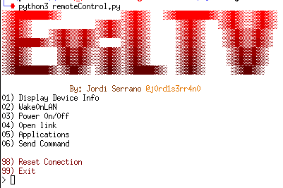

# 📺 **EvilTV - Remote Control & Stress Testing Tool for Smart TVs** 📺

### By: Jordi Serrano [@j0rd1s3rr4n0](https://github.com/j0rd1s3rr4n0)



[](https://www.python.org/)
[](LICENSE)
[](#-running-tests)
[]()

---

## 📖 Description

**EvilTV** is an advanced remote control and network assessment tool designed primarily for **Samsung Smart TVs** running **Tizen OS** (2016+). With **EvilTV**, you can interactively control your TV, automate commands, inspect technical hardware details, manage installed applications, explore and install apps from the official Samsung TV Store, and simulate background **Denial of Service (DoS)** attacks for stress testing.

Currently, **EvilTV** focuses on **Samsung TVs** via encrypted WebSocket (`8002`) and standard WebSocket/REST (`8001`) APIs, but its modular structure allows future expansion to other TV manufacturers.

---

## ✨ Key Features

- 🎮 **Interactive Remote Control**: Live keypad to control power, volume, mute, channel navigation, D-pad arrows, Enter/Return/Home/Menu, media playback, numbers, and arbitrary custom raw keys.
- 📱 **Installed Application Management**: List all installed applications in formatted tables; run, stop, inspect real-time status, open all, or close all with one click.
- 🛍️ **Samsung TV Store Browser**: Fast paginated browsing through thousands of official Samsung TV Store apps, with search-by-name and direct installation by App ID.
- ⚡ **Wake-on-LAN (WOL)**: Send magic packets to wake up TVs from sleep/standby, with automatic ARP MAC address resolution.
- 🛡️ **Simulated DoS (Stress Testing)**: Background, non-blocking multi-threaded stress testing engine featuring 3 simulated attack vectors.
- ⚙️ **Automatic Configuration**: Auto-discovery and connection probing on ports `8002` and `8001` with local caching in `config.cfg` and `tv-token.txt`.
- 🧪 **Automated Test Suite**: Complete unit test coverage for controller logic, background threads, and store API parsing.

---

## 📁 Project Structure

```
EvilTV/
├── remoteControl.py              # Main interactive CLI & controller logic
├── getSamsungTVStoreAppList.py   # Samsung TV Store API client & interactive browser
├── requirements.txt              # Core project dependencies
├── tests/                        # Automated unit test suite
│   ├── test_remote_control.py   # Controller & DoS thread lifecycle tests
│   └── test_store_apps.py       # Store API & pagination tests
├── config.cfg                    # Auto-generated device configuration cache
├── tv-token.txt                  # Paired authorization token
├── Screenshot.png                # Preview screenshot
├── LICENSE                       # MIT License
├── SECURITY.md                   # Security reporting policy
└── README.md                     # Documentation
```

---

## 📋 Installation

### Prerequisites

1. **Python 3.9+**: Ensure Python is installed on your machine (`python3 --version`).
2. **Network Connection**: Your computer must be on the **same local network subnet** as the Samsung TV.

### Installation Steps

1. Clone the repository:
   ```bash
   git clone https://github.com/j0rd1s3rr4n0/EvilTV.git
   ```

2. Navigate to the project directory:
   ```bash
   cd EvilTV
   ```

3. (Recommended) Create and activate a virtual environment:
   ```bash
   python3 -m venv .venv
   source .venv/bin/activate
   ```

4. Install the dependencies:
   ```bash
   pip install -r requirements.txt
   ```

---

## 🧪 Running Tests

Verify your installation with the automated test suite:

```bash
python -m unittest discover -s tests -p "test_*.py" -v
```

---

## 🚀 Usage

### Running the Program

Launch the interactive console application:

```bash
python remoteControl.py
```

> [!NOTE]
> **First-Time Pairing**: When connecting to your Samsung TV for the first time, look at your TV screen and select **"Allow"** on the pairing prompt. The authentication token will be saved automatically to `tv-token.txt` for future sessions.

---

### Main Menu Options

```
--- EvilTV Main Menu --- [Idle]
01) Display Device Info
02) WakeOnLAN
03) Power On/Off
04) Open URL
05) Applications Management
06) Send Command (Interactive Remote Control)
07) View Available Apps (Samsung Store)
08) Select App by APP ID
09) Start DoS
10) Stop DoS
98) Reset Connection
99) Exit
```

| Option | Function | Details |
| :--- | :--- | :--- |
| **01** | **Display Device Info** | Renders a styled table with TV model, OS, IP, WiFi MAC, resolution, network type, firmware version, DUID, FrameTVSupport, GamePadSupport, and VoiceSupport. |
| **02** | **WakeOnLAN** | Sends a Wake-on-LAN magic packet to wake the TV from deep standby. |
| **03** | **Power On/Off** | Sends WOL wake signal followed by power toggle via WebSocket. |
| **04** | **Open URL** | Validates and opens a target URL inside the TV's native web browser. |
| **05** | **Applications** | Lists installed apps with a dedicated submenu to run, stop, inspect status, open all, close all, or install apps. |
| **06** | **Interactive Remote** | Opens a real-time remote control keypad to send continuous button presses (Vol+/-, Ch+/-, D-pad, Home, Back, Menu, Media, Numbers, Custom raw keys). |
| **07** | **View Store Apps** | Interactive store browser with pagination (`[N]`ext, `[P]`rev), search by title (`[S]`), and table formatting. |
| **08** | **Select App by ID** | Directly install, launch, or query the status of any App ID. |
| **09** | **Start DoS** | Launches a background, non-blocking stress test using one of 3 simulation modes. |
| **10** | **Stop DoS** | Signals and cleanly terminates any running background DoS worker. |
| **98** | **Reset Connection** | Deletes `config.cfg` and `tv-token.txt` to re-pair with a new or reconfigured TV. |
| **99** | **Exit** | Halts background tasks and safely exits the program. |

---

### 🎮 Interactive Remote Control Keypad

Selecting **Option 6** opens the interactive remote:

```
================================================================
                  📺 EVILTV - INTERACTIVE REMOTE CONTROL 📺
================================================================
  [1] Power           [2] Vol +           [3] Vol -           [4] Mute
  [5] Channel +       [6] Channel -       [7] Up              [8] Down
  [9] Left            [10] Right          [11] Enter          [12] Return
  [13] Home           [14] Menu           [15] Play           [16] Pause
  [17] Stop           [N] Number (0-9)    [C] Custom Raw Key  [Q] Back to Menu
================================================================
```

---

### ⚠️ Simulated DoS (Stress Testing) Modes

EvilTV provides three simulated **Denial of Service (DoS)** attack modes designed for network and hardware stress testing:

1. **Mode 1 - Open and close apps indefinitely**: Continuously launches and terminates applications in a rapid loop.
2. **Mode 2 - Wake On LAN and power off indefinitely**: Alternates between sending Wake On LAN packets and power-off toggles repeatedly.
3. **Mode 3 - Close all apps indefinitely**: Continuously sends close commands to all running applications on the television.

> [!TIP]
> **Non-blocking Execution**: The DoS worker runs in an independent background thread (`threading.Thread`). The main menu remains fully operational while an attack is active, allowing you to monitor the status or stop the test at any time using **Option 10**.

---

## ⚙️ Advanced Configuration

On first run, EvilTV creates a `config.cfg` JSON file caching connection parameters:

```json
{
    "ip": "192.168.1.100",
    "port": 8002,
    "wifi_mac": "AA:BB:CC:DD:EE:FF",
    "name": "[TV] Samsung QLED",
    "model_name": "QE55Q80T",
    "os": "Tizen",
    "resolution": "3840x2160",
    "network_type": "wireless",
    "firmware_version": "T-KTM2DEUC-2111.1"
}
```

You can manually edit this file or choose **Option 98 (Reset Connection)** in the main menu to reset it.

---

## 🛠 Technologies Used

- **Python 3.9+**: Core application runtime.
- **SamsungTVWS**: WebSocket and REST client for Tizen Smart TVs.
- **PrettyTable**: Structured console table formatting.
- **WakeOnLAN**: Magic packet generation for LAN power management.
- **Scapy**: ARP broadcast resolution for hardware MAC addresses.
- **Threading**: Decoupled, non-blocking background workers for stress testing.
- **Requests & Urllib3**: REST API communication with Samsung endpoints.
- **Unittest**: Automated testing suite.

---

## 📄 License

This project is licensed under the MIT License. See the [LICENSE](LICENSE) file for details.

---

## 🤝 Contributing

Contributions, bug reports, and pull requests are welcome! Feel free to open an issue or submit a PR on GitHub.

---

## 📞 Author & Contact

- **Author**: Jordi Serrano
- **GitHub**: [@j0rd1s3rr4n0](https://github.com/j0rd1s3rr4n0)
